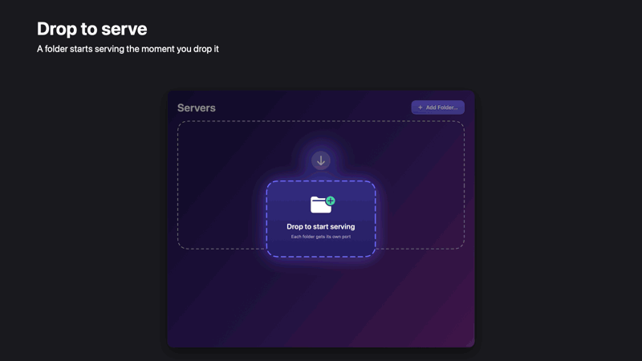
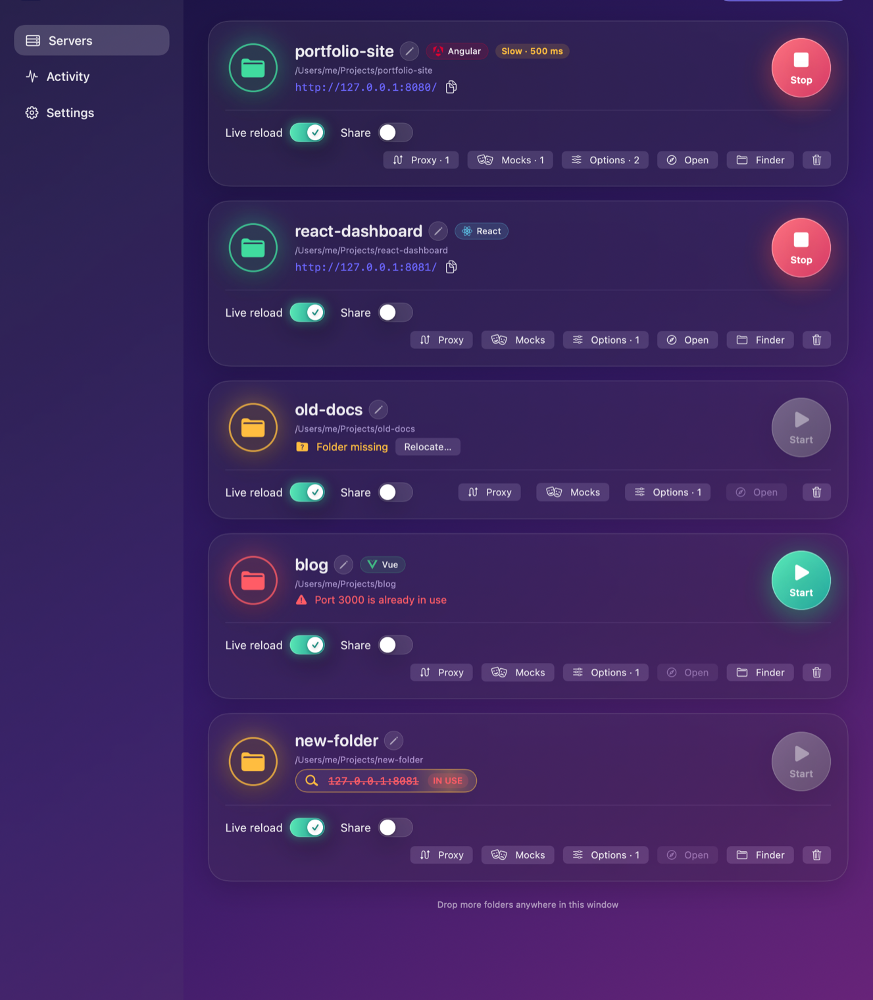
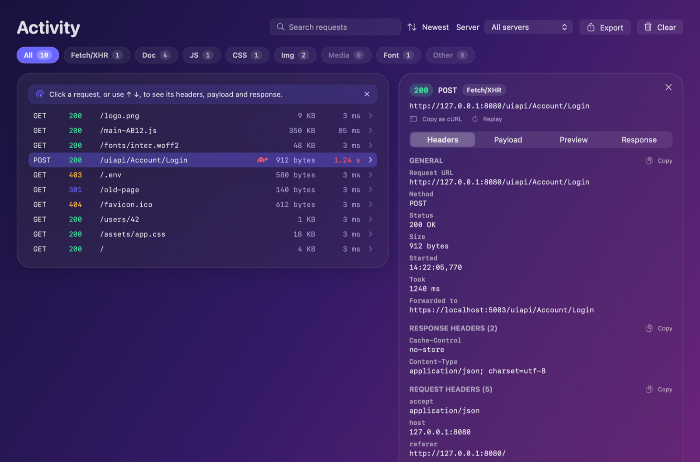
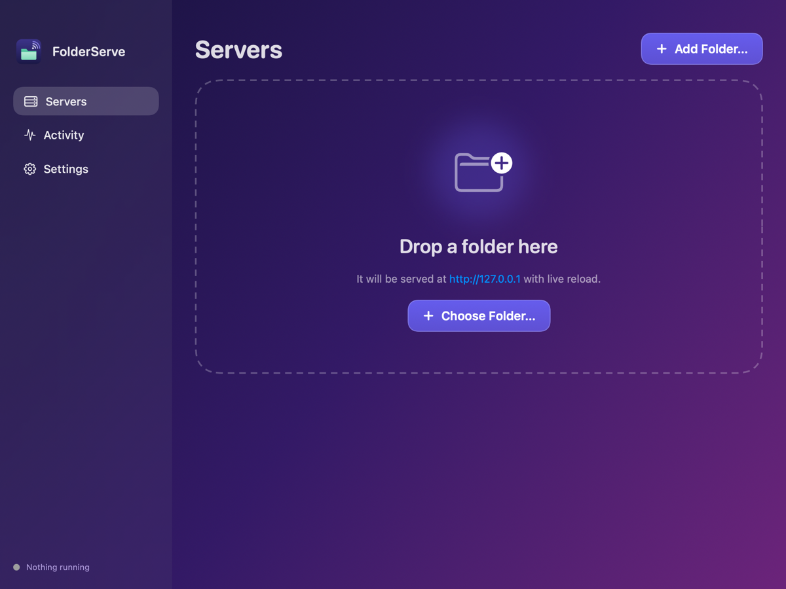
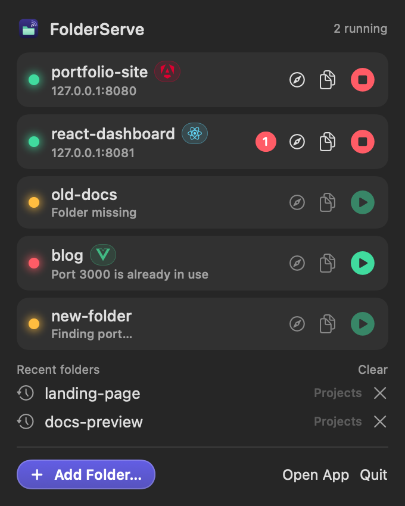
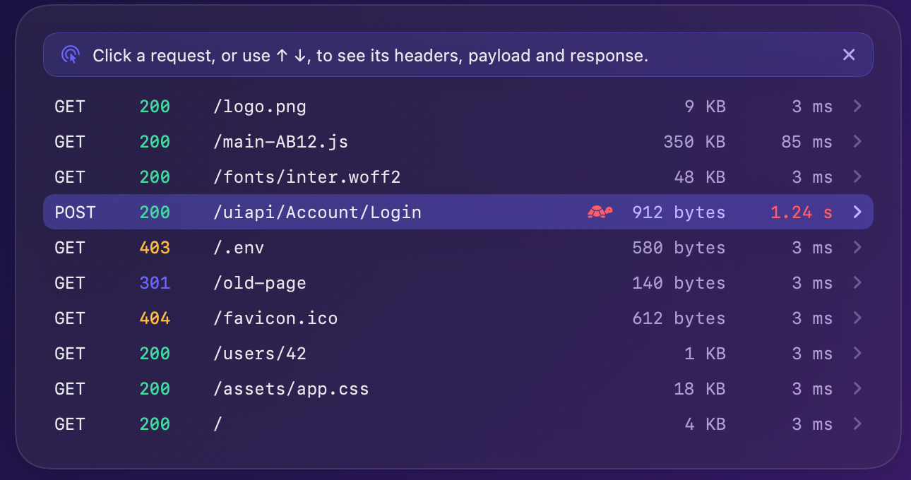
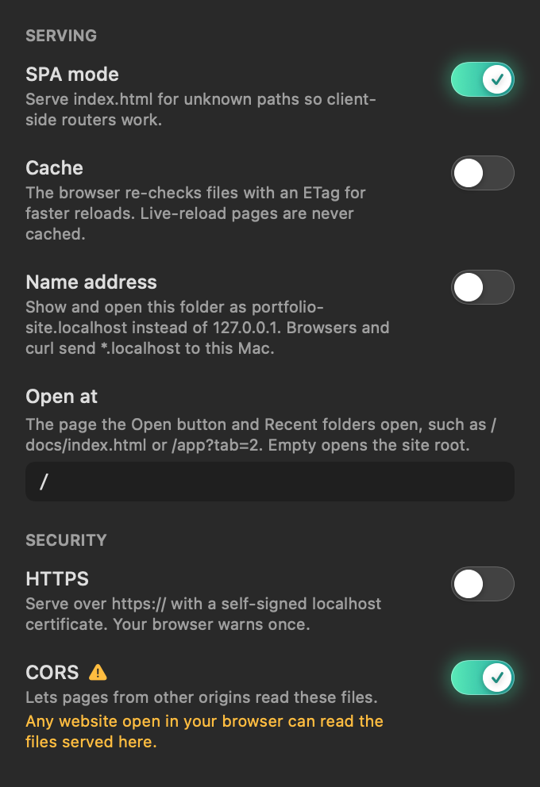
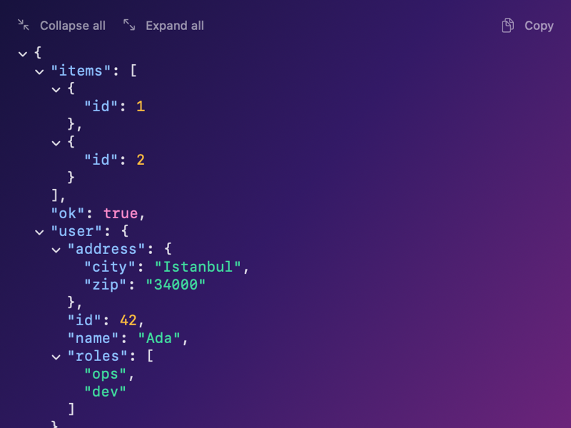
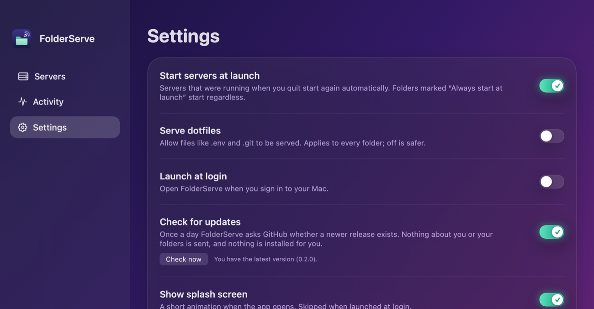
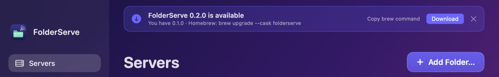

# FolderServe

[](https://github.com/fatihsenel/FolderServe/actions/workflows/ci.yml)

**Serve any folder on localhost and see every request your page makes — no terminal needed.**

A native macOS app (window + menu bar) for previewing static sites and single page apps: drop a folder, get a URL,
edit a file and the browser reloads. A dev-tools style Activity log shows each request with its timing, headers and
body, and can replay it, copy it as cURL or export it as a HAR file.

**Why not `npx serve` or `python -m http.server`?** Those are fine for a quick look. FolderServe is for when you keep
several folders open all day, want them back with one click after a restart, test on your phone, put an API behind a proxy,
or need to know why a request failed — without opening a terminal.



## Install

Download `FolderServe-<version>.zip` from the [latest release](https://github.com/fatihsenel/FolderServe/releases/latest),
unzip it and drag **FolderServe.app** to your Applications folder. The app is signed with a Developer ID certificate and notarized by Apple,
so it opens normally. It needs macOS 14 or later.

Or with Homebrew:

```bash
brew install --cask fatihsenel/tap/folderserve
```

To check a manual download, compare `shasum -a 256 FolderServe-<version>.zip` with the SHA-256 on the release page.
To build it yourself instead, see [Build](#build).

## Screenshots

Rendered from the app's built-in sample data (no real folders or requests).





| Empty state | Menu bar |
|---|---|
|  |  |

| Activity | Options |
|---|---|
|  |  |





## Features

- Drop a folder on the window, the Dock icon or the menu bar popover — it starts serving immediately. **⌘O** (File ▸ Add Folder…) opens the folder picker.
  Also works from Terminal: `open -a FolderServe ~/my-site`.
- **Recent folders**: a folder you remove from the list shows up under *Recent folders* in the menu bar popover. One click serves it again with its old name, port and options and opens it in your browser (the last six are kept; *Clear* forgets them all).
- Many folders at once, each on its own port (starts at 8080, next free port if busy).
- **Live reload**: a small script is injected into HTML pages; editing a file refreshes open tabs. When only `.css` files changed, the page swaps in the fresh stylesheets without reloading, so scroll position, form input and open menus stay.
- **SPA mode**: unknown extension-less paths return `index.html` (React Router, Vue Router, …).
  Missing assets (`/missing.js`) still return 404.
- Range requests (video/audio seeking), directory listings, correct MIME types, files streamed in chunks.
- Servers listen on `127.0.0.1` only. Path traversal (`..`, encoded, symlinks leaving the folder) → 403.
  Dotfiles (`.env`, `.git`) are not served unless you enable it in Settings.
- Activity log of requests with timings, filters by type and by status (success, redirects, errors), search, and a dev-tools style detail panel (JSON and XML bodies are coloured and can be folded; a page shows its total load time with the files it loaded), per-folder toggles, start-at-launch and launch-at-login.
- Optional API proxy, CORS, HTTPS and sharing on your network (each described below).

## Build

Requires Xcode 15+ (developed with Xcode 27) and [XcodeGen](https://github.com/yonaskolb/XcodeGen).

```bash
brew install xcodegen
xcodegen generate            # creates FolderServe.xcodeproj from project.yml
open FolderServe.xcodeproj   # or: xcodebuild -scheme FolderServe -destination 'platform=macOS' build
```

## Tests

```bash
swift test --package-path Packages/FolderServeCore                       # server logic (HTTP, paths, live reload)
xcodebuild test -scheme FolderServe -destination 'platform=macOS'        # app: server manager, open handling, UI snapshots
```

## Layout

- `Packages/FolderServeCore` — HTTP/1.1 server on `NWListener`, path resolver, live reload (FSEvents + SSE), port finder. No UI.
- `FolderServe/` — SwiftUI app: `Model/` (ServerManager, persistence), `UI/` (window, menu bar, theme).
- `docs/superpowers/` — design spec and implementation plan.
- `CLAUDE.md` — working notes for contributors and AI assistants (build, tests, conventions, git workflow).

## Previews

Every view has an Xcode preview in `FolderServe/UI/Previews.swift` (debug builds only), built on shared sample data
(`PreviewData`). Open the file and press ⌥⌘P to see them in the canvas. Views that read the server manager must be given
one in their preview, as the existing ones are.

## Known limits

- The app is sandboxed: it can only read folders you drop or pick. Dropping a single *file* grants access
  to that file only, so sibling files of a dropped file may not be readable.
- Dropping onto the menu bar *icon* itself is not supported (SwiftUI `MenuBarExtra`); drop on the popover instead.
- Requests whose `Host` header is not a loopback name (`localhost`, `*.localhost`, `127.x.x.x`, `[::1]`) get 403, to block DNS-rebinding
  attacks from web pages. This also means tunnels that forward a public hostname (ngrok etc.) are rejected.
- No CSS hot-swap (a CSS change reloads the page) — see the spec's out-of-scope list. HTTPS and LAN sharing exist but are
  off by default (see below).

## Project badges

Each server card (and menu bar row) shows the detected framework: Angular, React, Vue, Svelte, Next.js,
Nuxt, Astro, Vite or plain HTML. Source folders are identified from `package.json` / config files; built
output (`dist/`, `build/`) from markers in `index.html`. Detection for built output is heuristic. The mark
appears once the server has started. Logos are from [Simple Icons](https://simpleicons.org) (CC0); the
framework names and logos are trademarks of their owners.

The app icon source is `branding/AppIcon.svg`.

## CORS

Each folder has a **CORS** switch (off by default). When on, responses carry
`Access-Control-Allow-Origin: *` and `OPTIONS` preflight requests are answered, so a page on another
origin (for example an app on `localhost:4200`) can read files served here.

Turning it on lets *any* website open in your browser read those files, so leave it off unless you need it.
It does not help with errors from calling an API on another origin from your served app: for that, use the
API proxy below.

## HTTPS

Each folder has an **HTTPS** switch (off by default) for features that need a secure context (service workers,
some cookies, clipboard/camera APIs). The server then answers on `https://127.0.0.1:<port>/` using a self-signed
certificate for `localhost`, `127.0.0.1` and `::1`, created once with the system's `openssl` and stored in the app's
container. It is not issued by a trusted authority, so the browser shows a one-time warning: choose
Advanced → Proceed, or add `localhost.pem` (in `~/Library/Containers/…/FolderServe/Certificates`) to Keychain Access
and trust it. Switching the toggle restarts that folder's server.

## Share on your network

The **Share** switch (off by default) makes a folder reachable from other devices on your Wi-Fi/Ethernet. While it
is running a **QR** button shows a code to scan with a phone, plus the address (`http://192.168.x.x:<port>/`).
The server then listens on all interfaces, but only accepts requests addressed to loopback, private IPv4 addresses or
`.local` names, so DNS-rebinding tricks stay out. Everyone on the network can open the folder and use its proxy
rules while it is on, hence the warning icon. macOS may ask once to allow incoming connections.

## API proxy

The **Proxy** button on a folder card forwards requests that start with a prefix to another server, so the
browser only ever talks to one origin and CORS does not apply (like the proxy in Vite or Angular's dev server).

Example: `/uiapi` → `https://localhost:5003` sends `/uiapi/Account/Login` to
`https://localhost:5003/uiapi/Account/Login`. Tick "Remove prefix" to send `/Account/Login` instead.

- Methods: GET, POST, PUT, PATCH, DELETE, HEAD (request bodies up to 32 MB). Responses are streamed.
- Rules take precedence over files in the folder; invalid rules are ignored.
- **Hard-coded API address:** if your app has the target address in its files (for example
  `"baseUrl": "https://localhost:5003/uiapi/"` in `assets/config.json`), the browser would still call the API
  directly and hit CORS. With "Point this address at FolderServe in served files" (on by default), the address is
  replaced by this server's address in `.json`, `.js`, `.mjs` and `.html` files (up to 10 MB) as they are served.
  Files on disk are not changed. Addresses that are assembled in code (`"https://" + host`) are not detected.
- Self-signed certificates are accepted for `localhost` / `127.x` targets only (ASP.NET Core dev certificate).
- `Origin` and `Referer` are rewritten to the target. Redirects are not followed; a `Location` pointing at the
  target is turned into a local path.
- `Set-Cookie`: `Secure` and `Domain` are removed and `SameSite=None` becomes `Lax`, because the browser reaches
  the proxy over plain http.
- Requests from other origins (`Origin` or `Sec-Fetch-Site` not same-origin) get 403 unless CORS is on for the
  folder, so a web page cannot drive your backend through the proxy.
- WebSockets (and other `Upgrade` connections) pass through a proxy rule as a plain byte tunnel, so dev-server hot reload and SignalR work. The cross-origin guard applies to them too.
- Chunked request bodies (`Transfer-Encoding: chunked`) are joined and forwarded to the target with a `Content-Length`; `Expect: 100-continue` is answered. Other transfer codings (for example `gzip, chunked`) and HTTP/2 to the browser are not supported. The body limit is 32 MB.
- The app allows plain-http targets (`NSAllowsArbitraryLoads`), because the target is whatever you configure.

## Activity

The Activity tab lists requests with a dev-tools style category: Fetch/XHR, Doc, JS, CSS, Img, Media, Font and
Other. Click a chip to filter (the chips show counts for the chosen server). Each row shows the method, status, path, size and
**how long the server took** (grey when quick, amber from 300 ms, red from 1 s). Rows light up on hover and carry an arrow;
a one-time tip above the list says a request can be opened and goes away once you open one. When the list is narrow (for
example beside the detail panel) rows drop the clock time and type badge, then the size, so nothing wraps. The category comes from the
browser's `Sec-Fetch-Dest` header when it sends one, otherwise from the file extension; proxied API calls
are Fetch/XHR. Browsers also send `Sec-Fetch-Dest: empty` for preloads (e.g. `modulepreload` chunks), so plain
`.js`, `.css`, image, font and media files are always grouped by their type; `.json` and extensionless paths
requested that way stay Fetch/XHR. **Clear** removes the activity of the chosen server, or of all servers when "All servers" is selected.

### Request details

Click a request in Activity (or move with ↑ ↓, also from the search field with ↓) to open its details (Esc or × closes them): **Headers** (URL, status, time, size, request and
response headers), **Payload** (request body of proxied calls, JSON pretty-printed, forms decoded), **Preview**
(images rendered with their size, JSON and text, a sample line for fonts) and **Response** (raw body with Copy).

- **JSON is a tree.** In Preview and Payload a JSON object or array is coloured (keys, strings, numbers, `true`/`false`/`null`)
  and every object and array has an arrow to fold it; a folded node shows its size (`"roles": [ … 2 items ]`). **Collapse all**,
  **Expand all** and **Copy** (the whole body, pretty-printed) sit above it, and very long arrays start folded. Invalid or
  cut-off JSON, and bodies over 256 KB, are shown as plain text.

- Files served from your folder are read from disk when you open them, so nothing extra is kept in memory. If the
  proxy address was replaced in a file when it was served, the panel says so and shows the file on disk.
- For proxied calls the first 32 KB of the request and 128 KB of the response are kept (the rest is marked truncated).
  When kept bodies exceed 20 MB, the oldest requests lose their bodies (headers stay).
- Details are held in memory only: never written to disk, gone on Clear or quit. They are shown **unmasked**
  (`Authorization`, `Cookie`, request bodies such as passwords), as in browser dev tools.
- **Export** (button in the Activity header) saves the listed requests, after the server, category and search you chose, as a
  **HAR** file that Chrome DevTools (Network → import) and other tools open. It contains method, URL, query, headers, status,
  size and time, request bodies (text) and response bodies where known: captured bodies of proxied calls (marked when cut
  off) and served files read from disk (up to 2 MB, whole files only; binary content is base64). Headers such as
  `Authorization` and `Cookie` are included as sent, so treat the file as sensitive.
- Not included yet: audio/video preview, a timing waterfall, WebSocket frames.

### Why is a request listed twice?

Open a request that was made before and its detail shows a **Requested N times** note: how long ago the previous one
was, the likely cause (a preload followed by the real import, DevTools “Disable cache”, a second page load, a browser
prefetch, or two identical requests from the browser), and the request headers that differ between the two.

Requests that no page made (no referer, `Sec-Fetch-Site: none`, empty destination), which is what DevTools or an
extension does when it re-fetches a file to show it, are **hidden from the list** and from the category counts. A dashed
pill under the category chips says how many are hidden; click it to show them (the choice is remembered).

## Replay a request

Open a request in Activity and click **Replay** to send it again to the same server, with the same method, path, query,
headers and body. The answer shows up in Activity like any other request, marked **Replayed** (the `X-FolderServe-Replay`
header, which is never passed on to a proxy target). It needs the server to be running, and a body that was captured
whole (bodies are only kept for proxied calls, up to 32 KB). `Authorization` and cookies are sent as they were logged.

## Show in Finder

Each card has a **Finder** button (also in the right-click menu on the folder's name) that opens the folder in Finder.
Folders that are missing show no Finder button; use Relocate… instead.

## Choose the browser and the page to open

**Settings ▸ Open pages in** picks the browser used by a card's **Open** button, the menu bar's Recent folders and files opened with FolderServe:
the system default, or any of Safari, Chrome, Firefox, Edge, Brave, Arc, Opera, Vivaldi, Chromium, Orion and Zen that is installed.
A folder's **Options ▸ Open at** sets the page that opens instead of the site root, for example `/docs/index.html` or `/app?tab=2`
(it must be a path on the server; other addresses are refused).

## Name address

Turn on **Name address** in a folder's Options to show and open it as `my-site.localhost:8080` (the folder's name, lower-cased)
instead of `127.0.0.1:8080`. Browsers and curl send every `*.localhost` name to this Mac, so nothing needs configuring, and the
HTTPS certificate covers `*.localhost` too. The numeric address keeps working. Only names ending in `.localhost` are accepted, which keeps
DNS-rebinding hosts like `my-site.localhost.evil.com` out. Cookies are stored per host name, so two folders with the same name on different ports share them.

## Updates

FolderServe checks GitHub for a newer release once a day (and when you choose **FolderServe ▸ Check for Updates…** or **Settings ▸ Check now**).
If there is one, a notice at the top of the window offers **Download** (the release page) and the Homebrew command
`brew upgrade --cask folderserve`. It never installs anything itself.



The check sends a plain request for the latest release of `fatihsenel/FolderServe` and nothing else: no folders, requests or identifiers.
Turn it off with **Settings ▸ Check for updates**. Closing the notice hides that version until a newer one appears.

## Releasing

`scripts/release.sh` builds a Release archive, signs it with a **Developer ID Application** certificate, notarizes it with Apple, staples the
ticket and zips it into `build/release/FolderServe-<version>.zip` (the version is `MARKETING_VERSION` in `project.yml`). With `--publish` it
also creates a public GitHub release with the zip and its SHA-256.

One-time setup, as the team's **Account Holder** (team `XC7ZHWDHCA`):

1. Create the certificate: Xcode ▸ Settings ▸ Accounts ▸ Manage Certificates ▸ + ▸ Developer ID Application. Back up the key (Keychain Access ▸ export as `.p12`).
2. Create an app-specific password at appleid.apple.com, then store a notarization profile (it asks for the password):
   `xcrun notarytool store-credentials "folderserve-notary" --apple-id <your Apple ID> --team-id XC7ZHWDHCA`
3. Run `scripts/release.sh`. `TEAM_ID` and `NOTARY_PROFILE` can be overridden in the environment.

The script stops with a message if the certificate or the notarization profile is missing.

## Dropping folders

While you drag a folder over the window the list dims and a landing pad appears ("Drop to start serving"). On drop
a burst of rings and sparks plays where you let go, the new card pops in, scrolls into view and glows green for a
couple of seconds (also when you drop a folder that is already listed, or open one via the Dock or `open -a`).
With Reduce Motion on, the dashes, ripples and sparks are replaced by a simple fade.

## Removing a folder

The trash button on a card opens a confirmation over the window: the folder's name, framework and path, then what
will happen (its server stops, its settings such as a custom name and proxy rules are forgotten) and a reminder that
the files in the folder are never deleted. Cancel (or Esc, or a click outside) keeps everything; Remove confirms.

## Contributing and security

Bug reports, ideas and pull requests are welcome: see [CONTRIBUTING.md](CONTRIBUTING.md). Please report security problems privately, as described in
[SECURITY.md](SECURITY.md).

## License

[MIT](LICENSE)
